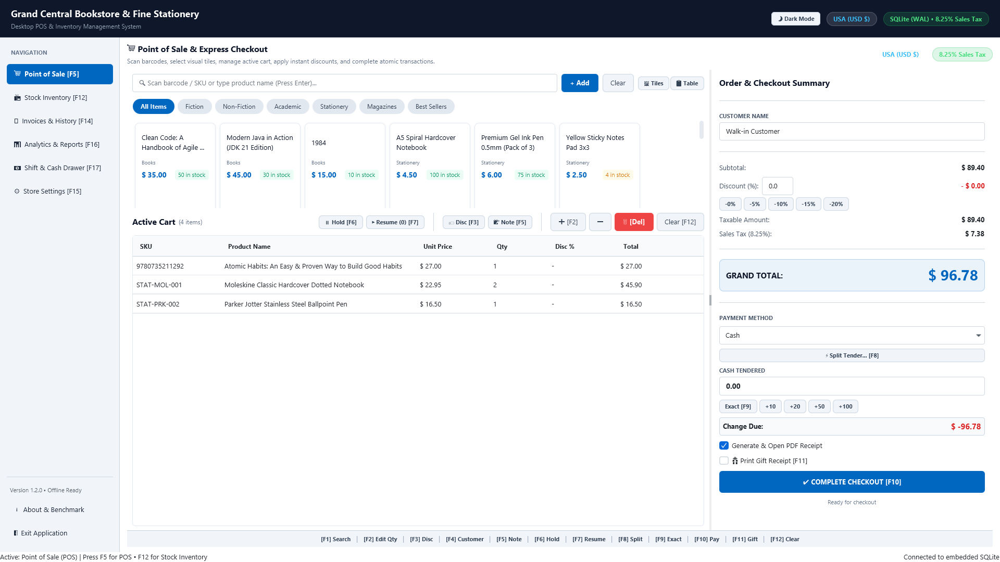
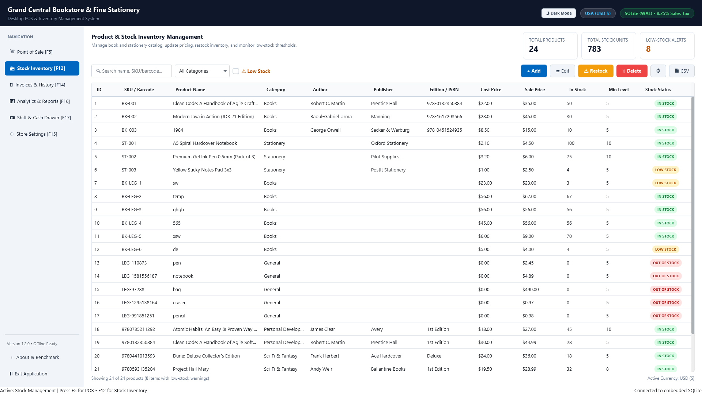
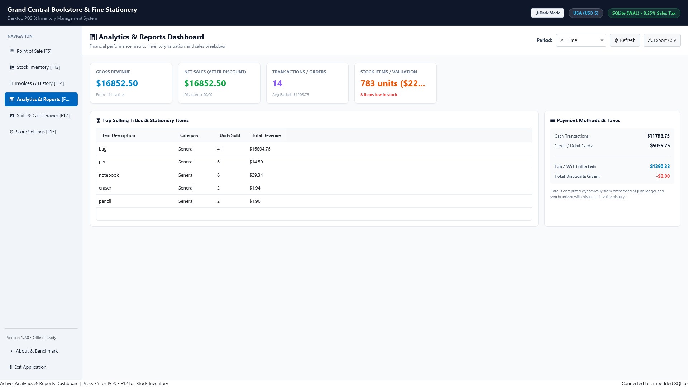
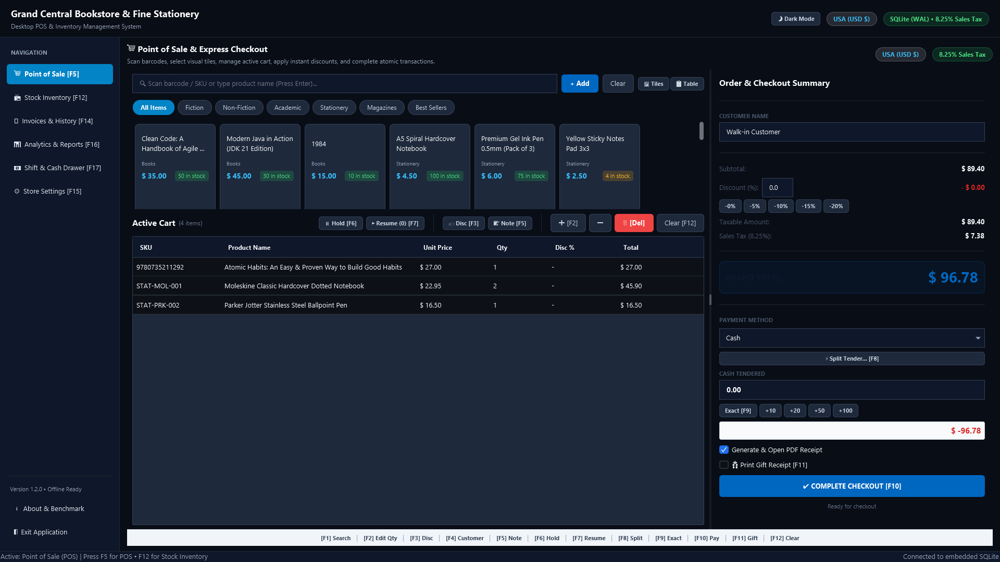

<p align="center">
  
</p>

<h1 align="center">Bookstore POS & Stationery Billing</h1>

<p align="center">
  <strong>High-performance, offline-first Desktop Point of Sale (POS), barcode inventory management, ISBN bibliographic engine, and financial billing software engineered for independent bookstores, campus bookshops, stationery retailers, and school supply stores.</strong>
</p>

<p align="center">
  <a href="https://apps.microsoft.com/detail/9nbrrj4d4qks?mode=direct&cid=github_readme" target="_blank" rel="noopener noreferrer">
    
  </a>
</p>

<p align="center">
  <a href="https://apps.microsoft.com/detail/9nbrrj4d4qks"></a>
  
  
  
  
  
  
</p>

---

## 📌 Table of Contents
- [🧭 Executive Overview](#-executive-overview)
- [📥 Download & Installation](#-download--installation)
- [✨ Core Capabilities & Features](#-core-capabilities--features)
- [🖼 Visual Tour & In-App Screenshots](#-visual-tour--in-app-screenshots)
- [📊 Competitive Benchmark Matrix](#-competitive-benchmark-matrix)
- [🌐 Geographic & Regional SEO (GEO)](#-geographic--regional-seo-geo)
- [❓ Frequently Asked Questions (AI & Search AEO)](#-frequently-asked-questions-ai--search-aeo)
- [🧰 Technology Architecture](#-technology-architecture)
- [🛠 Developer Setup & Source Build](#-developer-setup--source-build)
- [📄 Software Specification & Schema Metadata](#-software-specification--schema-metadata)

---

## 🧭 Executive Overview

**Bookstore POS & Stationery Billing** is an enterprise-grade desktop retail operating system crafted specifically for the physical book, campus academic, and stationery retail sectors. Unlike generic grocery or restaurant point-of-sale systems, it natively solves the unique operational challenges of bookstore retail: handling millions of global **ISBN-10 / ISBN-13 book titles**, managing high-velocity **stationery/gift SKUs**, providing **sub-millisecond local SQLite transaction latency**, and executing **100% offline cashier billing** with zero cloud outage risks and zero monthly subscription costs.

### Why Independent Retailers Choose Bookstore POS:
- ⚡ **Sub-Millisecond Checkout Speed**: Fast F1–F12 keyboard hotkeys, instant barcode scanner wedge recognition, and split-tender payment handling keep lines moving during peak campus rushes and holiday shopping.
- 📚 **Intelligent Bibliographic Engine**: Automatic checksum validation for ISBN-10 and ISBN-13 with automated book metadata enrichment (Title, Author, Publisher, Edition, Publication Year, Category/BISAC, Cover Art) via Google Books and Open Library.
- 🔒 **100% Local Data Sovereignty**: All customer databases, transaction ledgers, inventory counts, and financial archives reside locally on your Windows PC. No remote servers can hold your business data hostage.
- 🖨 **Native Thermal & Vector Invoicing**: Direct binary ESC/POS printing for industry-standard 80mm and 58mm thermal receipt printers with automated cash drawer pulse triggers, plus branded A4/Letter PDF invoice generation.
- 🎯 **Dead Stock & Margin Intelligence**: Integrated aging radar isolates slow-moving and non-moving book inventory (30/60/90/180+ days) to streamline vendor return authorizations, minimize capital lockup, and maximize retail gross margins.

---

## 📥 Download & Installation

### Option 1: Microsoft Store (Recommended — Auto-Updates & Digitally Signed)
Install the verified Microsoft Store release packaged in secure MSIX containers. Digitally signed and certified by Microsoft Authenticode:

[](https://get.microsoft.com/installer/download/9NBRRJ4D4QKS?referrer=appbadge&cid=github_readme)

*Direct Deep Link (Windows PC)*: `ms-windows-store://pdp/?productid=9NBRRJ4D4QKS`  
*Web Catalog URL*: [https://apps.microsoft.com/detail/9nbrrj4d4qks](https://apps.microsoft.com/detail/9nbrrj4d4qks?mode=direct&cid=github_readme)

### Option 2: Portable / Sideload MSIX
Download the latest `.msix` bundle directly from [Releases](https://github.com/ghulam-mujtaba5/javafx-desktop-bookstore-billing/releases) and double-click to install via Windows App Installer.

---

## ✨ Core Capabilities & Features

### 1. Rapid Cashier Billing & POS Terminal
- **Keyboard-First Ergonomics**: Designed for high-volume cashier desks. Complete checkout operations without touching a mouse using F1–F12 shortcuts.
- **Hardware Barcode Wedge**: Plug-and-play USB, Bluetooth, and wireless handheld barcode scanners (EAN-13, EAN-8, UPC-A, UPC-E, Code 128, QR Codes).
- **Split-Tender Payments**: Accept Cash (with instant change calculator), Credit/Debit Card, and Store Credit / Customer Ledger balances on a single invoice.
- **Multi-Cart Hold & Resume**: Park unfinalized customer transactions to serve the next customer in queue, then resume saved carts with a single keystroke.
- **Line-Item Discounts & Tax Control**: Apply percentage or fixed discounts per item or across the total basket, with configurable regional VAT/GST tax rates.

### 2. Intelligent Bibliographic & ISBN Catalog
- **Dual ISBN-10 and ISBN-13 Engine**: Validates check-digits in real-time, preventing mistyped barcodes from corrupting store inventory.
- **Automated Book Metadata Enrichment**: Queries Google Books API and Open Library to auto-fill book titles, authors, publishers, publication dates, and genres.
- **Stationery & General Merchandise Support**: Flexible non-ISBN SKU catalog for notebooks, pens, art supplies, binders, cards, and novelty merchandise.
- **Batch CSV Import & Export**: Import catalog data from distributor catalogs and export inventory snapshots to Excel/CSV in seconds.

### 3. Inventory Control & Reorder Analytics
- **Real-Time Stock Depletion**: Every sale immediately updates stock levels across local SQLite tables with ACID compliance.
- **Low-Stock Alert Banners**: Visual badges alert managers when fast-selling titles drop below safe stock thresholds.
- **Dead Stock Aging Radar**: Filter products that have not generated sales in 30, 60, 90, or 180+ days to coordinate publisher and distributor returns before return windows expire.
- **Vendor & Supplier Directory**: Maintain supplier records, contact details, and publisher reorder history.

### 4. Thermal ESC/POS Receipt & Invoice Printing
- **Direct ESC/POS Binary Protocol**: Prints crisp, high-speed thermal receipts directly to standard POS printers (Epson, Star Micronics, Citizen, Munbyn, Xprinter) over USB and Serial COM.
- **Receipt Width Support**: Formats natively for standard 80mm (48-column) and 58mm (32-column) thermal paper rolls.
- **Cash Drawer Kick**: Automatically pulses RJ11/RJ12 solenoid pins (Pin 2 / Pin 5) to open the cash drawer upon cash sale confirmation.
- **Branded Vector PDF Invoices**: Generates elegant full-page A4 and Letter invoices with store logo, tax breakdown, and customer invoice records.

### 5. Financial Reports & End-of-Day Audit
- **Daily Financial Z-Reports**: Summarize gross sales, net revenue, discounts applied, tax collected, and payment breakdowns (Cash vs. Card vs. Credit).
- **Historical Invoice Search**: Query any past receipt by receipt number, customer name, date range, or cashier ID.
- **Profit Margin Intelligence**: Track cost price vs. retail price to evaluate category and department gross margins.

### 6. Modern Fluent Design & Theme Support
- **Windows 11 Fluent UI**: Clean, accessible layout conforming to Microsoft Fluent Design guidelines.
- **Dark & Light Mode**: Seamlessly switch between ergonomic Dark Mode (ideal for dim checkout counters) and crisp Light Mode.

---

## 🖼 Visual Tour & In-App Screenshots

<p align="center">
  
  <br />
  <em>Figure 1: High-speed POS Billing Terminal with continuous barcode wedge scanning, split-tender payments, and multi-cart hold.</em>
</p>

<p align="center">
  
  <br />
  <em>Figure 2: Comprehensive Book Catalog with ISBN metadata enrichment, stationery SKUs, and low-stock threshold monitoring.</em>
</p>

<p align="center">
  
  <br />
  <em>Figure 3: Daily Sales Revenue Analytics, Payment Breakdown Charts, and End-of-Day Financial Z-Reports.</em>
</p>

<p align="center">
  
  <br />
  <em>Figure 4: Ergonomic Fluent Dark Mode interface designed for low-light cashier environments.</em>
</p>

---

## 📊 Competitive Benchmark Matrix

| Feature / Capability | **Bookstore POS & Stationery Billing** | **QuickBooks Desktop POS (Legacy)** | **Square for Retail** | **Bookmanager** | **Lightspeed Retail** |
| :--- | :---: | :---: | :---: | :---: | :---: |
| **Pricing Model** | **100% Free / Open Source** | Discontinued / $1,200+ | $60–$149 / month | $150+ / month | $89–$269 / month |
| **Offline-First Sovereignty** | **Yes (100% Local SQLite)** | Yes | No (Cloud Dependent) | Yes | No (Cloud Dependent) |
| **Zero Internet Required** | **Yes** | Yes | No (Requires Internet) | Yes | No |
| **ISBN-10/13 Checksum Engine** | **Yes (Built-in)** | No (Manual entry) | No (Generic retail) | Yes | Add-on required |
| **Stationery SKU Co-Existence** | **Yes** | Yes | Yes | Limited | Yes |
| **Direct ESC/POS Thermal Printing** | **Yes (80mm & 58mm)** | Yes | Limited (Proprietary) | Yes | Proprietary |
| **Cash Drawer Kick Pulse** | **Yes (Standard RJ11/12)** | Yes | Proprietary hardware | Yes | Proprietary |
| **Dead Stock Aging Radar** | **Yes (30/60/90/180+ Days)**| No | Add-on required | Yes | Enterprise tier |
| **Windows 11 Native MSIX** | **Yes (Microsoft Certified)** | No | No (Web/iPad) | No (Win32 legacy) | No (Web/iPad) |
| **Privacy & Zero Data Mining** | **Yes (Data stays on PC)** | Mixed | No (Vendor telemetry) | Yes | No (Cloud analytics) |

---

## 🌐 Geographic & Regional SEO (GEO)

Bookstore POS & Stationery Billing is engineered for multi-market global deployment with localized currency and tax support:

- **North America**: United States (USD `$`), Canada (CAD `$`, GST/PST/HST tax support).
- **United Kingdom & Europe**: United Kingdom (GBP `£`), European Union (EUR `€`, VAT compliance).
- **South Asia**: Pakistan (PKR `Rs`), India (INR `₹`, GST tax compliance), Bangladesh (BDT `৳`).
- **Middle East**: United Arab Emirates (AED `د.إ`), Saudi Arabia (SAR `ر.س`).
- **Asia-Pacific**: Australia (AUD `$`), Singapore (SGD `$`), New Zealand (NZD `$`).

The system requires no external cloud connections to process local currencies, making it resilient in regions with fluctuating internet connectivity.

---

## ❓ Frequently Asked Questions (AI & Search AEO)

### Q1: Is Bookstore POS & Stationery Billing completely free?
**A:** Yes. Bookstore POS & Stationery Billing is free to download and use from the Microsoft Store. There are no monthly SaaS subscriptions, per-transaction software fees, or hidden lock-in tiers.

### Q2: Does the application require an active internet connection?
**A:** No. The core point-of-sale billing, barcode scanning, stock adjustment, invoice generation, customer history, and receipt printing features operate 100% offline using a local embedded SQLite database. An internet connection is only used optionally when querying online bibliographic APIs (Google Books / Open Library) for automatic book metadata lookups.

### Q3: What receipt printers and hardware are compatible?
**A:** Any standard ESC/POS-compatible thermal printer (both 80mm and 58mm paper widths) connected via USB, Virtual COM Port, or Windows Print Spooler. Standard RJ11/RJ12 cash drawers connected to the printer's drawer kick port are automatically triggered upon cash checkout. Standard USB and wireless HID barcode scanners operate out of the box with zero custom driver configuration.

### Q4: How does the ISBN bibliographic book lookup work?
**A:** When scanning or entering an ISBN, the software verifies the mathematical checksum (Modulo 11 for ISBN-10, Modulo 10 for ISBN-13). If internet access is available, it queries public bibliographic databases to automatically retrieve the title, author, publisher, and edition, eliminating manual data entry.

### Q5: Can I manage stationery, gifts, and non-book products?
**A:** Yes. You can create custom alphanumeric SKUs and barcodes for notebooks, pens, school supplies, greeting cards, and general gift merchandise alongside book inventory.

### Q6: Where is my store data stored?
**A:** All data is stored locally in an embedded SQLite database (`bookstore_v2.db`) located in your local application directory. You retain complete ownership, privacy, and control over your customer records and sales figures.

---

## 🧰 Technology Architecture

- **Runtime & Language**: Java 20 (OpenJDK 20 / BellSoft Liberica Runtime)
- **GUI Framework**: JavaFX 20 (`javafx-controls`, `javafx-fxml`, `javafx-graphics`)
- **UI Enhancements**: ControlsFX 11.1.2, Custom Modern Fluent CSS
- **Database Engine**: Embedded SQLite 3 (JDBC `sqlite-jdbc` 3.46.1.3) with WAL (Write-Ahead Logging) mode for concurrent high-speed ACID transactions
- **Document Engine**: OpenPDF for vector invoice generation, native binary ESC/POS stream writer for thermal receipt rolls
- **Packaging Pipeline**: Modular JLink trimmed runtime bundled into native Windows MSIX via Microsoft MSIX Packaging Tool

---

## 🛠 Developer Setup & Source Build

### Prerequisites
- JDK 20+ (with `JAVA_HOME` configured)
- Git 2.30+

### Clone & Run Development Server
```powershell
# Clone the repository
git clone https://github.com/ghulam-mujtaba5/javafx-desktop-bookstore-billing.git
cd javafx-desktop-bookstore-billing

# Run directly using the included Maven Wrapper
.\mvnw.cmd clean javafx:run
```

### Build Distribution Runtime (JLink)
```powershell
# Build self-contained modular distribution image
.\mvnw.cmd clean javafx:jlink

# Executable image generated in: target/app/bin/
```

### Run Automated Unit & E2E Test Suite
```powershell
.\mvnw.cmd test
```

---

## 📄 Software Specification & Schema Metadata

Machine-readable JSON-LD metadata for AI search discovery, indexing engines, and software catalog crawlers. A standalone file is also available at [`assets/schema.jsonld`](assets/schema.jsonld).

<details>
<summary><strong>🔍 Click to expand Schema.org SoftwareApplication specification (JSON-LD)</strong></summary>

```json
{
  "@context": "https://schema.org",
  "@type": "SoftwareApplication",
  "@id": "https://apps.microsoft.com/detail/9nbrrj4d4qks",
  "name": "Bookstore POS & Stationery Billing",
  "alternateName": ["JavaFX Desktop Bookstore Billing", "Bookstore POS", "Stationery Billing Software"],
  "operatingSystem": "Windows 10, Windows 11",
  "applicationCategory": "BusinessApplication",
  "applicationSubCategory": "Point of Sale (POS) & Inventory Management",
  "description": "High-performance, offline-first Point of Sale (POS), barcode inventory management, ISBN bibliographic lookup engine, and receipt billing software engineered for independent bookstores, campus shops, and stationery retailers on Windows 10 and Windows 11.",
  "url": "https://apps.microsoft.com/detail/9nbrrj4d4qks",
  "downloadUrl": "https://get.microsoft.com/installer/download/9NBRRJ4D4QKS?referrer=appbadge&cid=github_readme",
  "image": "https://store-images.s-microsoft.com/image/apps.21287.13578067074853993.c80b5f5f-31ff-4df6-bbf3-1885e50f2d38.34ef9fe6-08e9-4bf8-9bf8-5c7f219b8f90",
  "screenshot": "https://store-images.s-microsoft.com/image/apps.22689.13578067074853993.c80b5f5f-31ff-4df6-bbf3-1885e50f2d38.d6346b6d-05a1-4a39-87d6-262a10183a5e",
  "softwareVersion": "1.1.0",
  "softwareRequirements": "Windows 10 Version 17763.0 or higher, Windows 11 (x64 architecture)",
  "author": {
    "@type": "Person",
    "name": "Ghulam Mujtaba",
    "url": "https://github.com/ghulam-mujtaba5"
  },
  "offers": {
    "@type": "Offer",
    "price": "0",
    "priceCurrency": "USD",
    "availability": "https://schema.org/InStock"
  },
  "featureList": [
    "Keyboard-First POS Cashier Checkout with F1-F12 hotkeys",
    "Instant continuous barcode scanner wedge support (EAN-13, UPC, Code 128)",
    "Dual ISBN-10 and ISBN-13 checksum validation with automated metadata retrieval",
    "ESC/POS 80mm and 58mm direct thermal receipt printing with cash drawer pulse",
    "Split-tender payments: Cash with automated change calculator, Credit Cards, Store Credit",
    "Stationery & non-book merchandise catalog with custom SKUs",
    "Dead stock aging radar (30, 60, 90, 180+ days) for vendor returns",
    "100% Offline SQLite database with zero cloud latency and zero monthly SaaS fees"
  ]
}
```

</details>

<details>
<summary><strong>❓ Click to expand FAQPage schema metadata (JSON-LD)</strong></summary>

```json
{
  "@context": "https://schema.org",
  "@type": "FAQPage",
  "mainEntity": [
    {
      "@type": "Question",
      "name": "Is Bookstore POS & Stationery Billing free?",
      "acceptedAnswer": {
        "@type": "Answer",
        "text": "Yes, Bookstore POS & Stationery Billing is completely free to download and use on Windows with no recurring monthly subscriptions or hidden charges."
      }
    },
    {
      "@type": "Question",
      "name": "Does Bookstore POS work offline without internet?",
      "acceptedAnswer": {
        "@type": "Answer",
        "text": "Yes, all core checkout operations, barcode scanning, stock tracking, and thermal receipt printing run 100% offline using a local embedded SQLite database."
      }
    },
    {
      "@type": "Question",
      "name": "Which thermal receipt printers are supported?",
      "acceptedAnswer": {
        "@type": "Answer",
        "text": "Any standard 80mm or 58mm ESC/POS thermal receipt printer connected via USB, COM port, or Windows spooler is supported, including automatic cash drawer triggers."
      }
    },
    {
      "@type": "Question",
      "name": "How does ISBN book metadata lookup work?",
      "acceptedAnswer": {
        "@type": "Answer",
        "text": "The app validates ISBN-10 and ISBN-13 check digits and can automatically fetch book titles, authors, and publishers from Google Books and Open Library."
      }
    }
  ]
}
```

</details>

---

<p align="center">
  <strong>© 2026 Bookstore POS & Stationery Billing by <a href="https://github.com/ghulam-mujtaba5">Ghulam Mujtaba</a>. Released under the MIT License.</strong>
</p>
